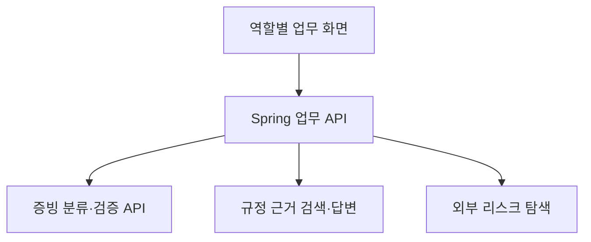

# SmartChain AI Services

[](https://github.com/withoutsultang/SmartChain_AI/actions/workflows/live-integration.yml)

> 증빙 분류·내용 검증·교차검증·규정 검색을 하나의 업무 플랫폼으로 연결하는 AI 서비스

**KT AIVLE School 빅프로젝트 · 7인 팀 · 최우수상(2위)**

협력사의 증빙 제출부터 검토·승인·보완 요청까지 연결하는 **AI 기반 공급망 리스크 관리 플랫폼**입니다. ESG·안전보건·하도급 컴플라이언스의 세 업무 영역을 하나의 제출·검토 흐름으로 구성했습니다.

## 실제 서비스 시연


**기안 생성 → 증빙 9개 업로드·분류 → 실제 AI 분석 → 회사 결재 → 원청 심사·보완 요청 → 최종 승인**을 연결했습니다. 합성 문서로 실제 서비스를 실행해 캡처한 15.4초 시연입니다.

[화면 7개 보기](https://github.com/withoutsultang/SmartChain_Frontend/tree/develop/docs/demo) · [실행 결과와 검증 근거](https://github.com/withoutsultang/SmartChain_AI/blob/main/docs/verification.md)

## 플랫폼 구조



|서비스|처리 내용|실행 포트|
|---|---|---|
|[ai_run_api](apps/ai_run_api/README.md)|Preview 분류·Submit 검증·슬롯 간 교차 비교·보완 문구|8000|
|[chatbot_api](apps/chatbot_api/README.md)|Chroma 검색·후보 재정렬·문서 근거를 연결한 RAG 답변|8001|
|[out_risk_api](apps/out_risk_api/README.md)|협력사 외부 기사 탐색·위험 신호 요약|8002|

## 김건우의 기여: AI를 업무 서비스로 연결

AI 엔진은 팀 AI 파트의 결과물이며, 김건우는 **공통 AI 계약·백엔드 연동·분석 결과 저장/조회·업무 화면 표현·오류 복구**를 담당했습니다. 모델의 응답이 제출·검토 업무에 이어지도록 인터페이스를 구성한 프로젝트입니다.

- [공통 Preview/Submit 클라이언트](https://github.com/SmartChain-HD/Backend/pull/40): 도메인마다 별도 클라이언트를 만드는 대신 공통 요청·응답 계약 적용
- [파일 준비 상태·날짜 검증](https://github.com/SmartChain-HD/Backend/pull/210): 외부 AI 호출 전 전제조건과 오류 코드 분리
- [Preview 타임아웃 분리](https://github.com/SmartChain-HD/Backend/pull/212): 경량 분류와 전체 검증의 대기 정책 분리
- [교차검증 DTO](https://github.com/SmartChain-HD/Backend/pull/231) · [결과 화면](https://github.com/SmartChain-HD/Frontend/pull/407): 비교 대상·판정·사유를 업무 언어로 구조화

## 엔진의 주요 구성

1. **Preview**: 파일명 규칙과 LLM 보강으로 증빙 슬롯 분류
2. **Submit**: PDF·표·이미지 추출, 도메인별 사유 검증, 출석부/사진 등 교차 비교
3. **결과 계약**: PASS/NEED_CLARIFY/NEED_FIX와 위험도, 파일 근거·보완 문구 반환
4. **규정 Q&A**: 문서 검색과 근거 문맥을 연결한 답변

숫자·배열·중첩 근거도 JSON 타입을 유지하도록 응답 계약을 구성하고, 실제 교차검증 결과의 직렬화 회귀 시험을 제공합니다.

## 로컬 실행

Python 3.11 이상과 가상환경을 권장합니다. `.env.example`을 참고해 필요한 서비스의 환경변수를 설정합니다.

```bash
python -m venv .venv
# macOS/Linux: source .venv/bin/activate
# Windows: .venv\Scripts\activate
pip install -r requirements.txt
# 각 명령을 별도 터미널에서 실행
uvicorn app.main:app --reload --port 8000 --app-dir apps/ai_run_api
uvicorn app.main:app --reload --port 8001 --app-dir apps/chatbot_api
uvicorn app.main:app --reload --port 8002 --app-dir apps/out_risk_api
# API 호출 없이 응답 계약 검증
python -m unittest discover -s tests -v
```

API 호출 없는 회귀 시험은 **Actions → Portfolio checks**, 실제 OpenAI·Clova·PostgreSQL·브라우저 검증은 **Actions → Live portfolio integration → Run workflow**에서 실행합니다. [검증 스크립트와 준비](scripts/portfolio/README.md) · [실행 결과](docs/verification.md)

## 프로젝트 저장소

[Backend](https://github.com/withoutsultang/SmartChain_Backend) · [Frontend](https://github.com/withoutsultang/SmartChain_Frontend) · [AI](https://github.com/withoutsultang/SmartChain_AI)

팀 원본: [SmartChain-HD/AI](https://github.com/SmartChain-HD/AI). 이 포크는 AI 서비스 구조와 개인의 시스템 연동 경험을 함께 보여주는 포트폴리오입니다.
